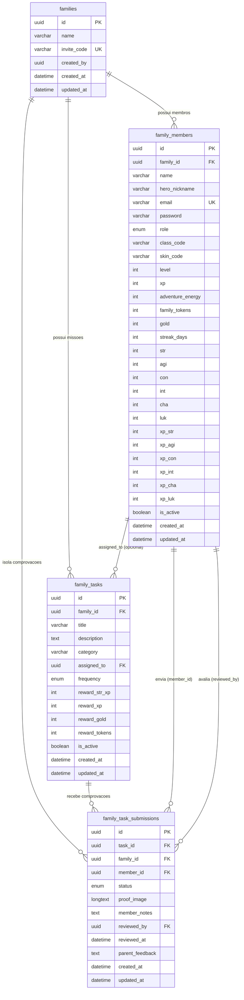

# 🗄️ LiraQuest — Arquitetura e Mapa do Banco de Dados (V2)

Este documento descreve a modelagem oficial do banco de dados **MySQL** do **LiraQuest (Arquitetura V2 Unificada)** conectado via Sequelize (`backend/src/config/database.js`), seu diagrama entidade-relacionamento, o detalhamento exato das tabelas ativas, o seed inicial e a previsão estrutural do roadmap.

---

## 1. Padrões Obrigatórios da Arquitetura V2

1. **Identificadores UUIDv4 Obrigatórios:**
   - Todas as chaves primárias (`id`) e chaves estrangeiras (`*_id`, `family_id`) utilizam `DataTypes.UUID` gerados automaticamente por `DataTypes.UUIDV4`.
2. **Nomenclatura SQL e Sequelize:**
   - **Tabelas SQL:** `snake_case` minúsculo com prefixo `family_` para entidades do domínio (e `families` para a entidade raiz de clã).
   - **Modelos Sequelize:** Classes e arquivos em `PascalCase` (ex.: `FamilyMember.js`, `FamilyTask.js`), configurados explicitamente com `tableName`, `timestamps: true` e `underscored: true` (mapeando `created_at` e `updated_at`).
3. **Entidade Unificada (`family_members`):**
   - O usuário e o herói são a **mesma entidade** em produção. Credenciais de acesso, dados familiares, recursos de economia (`gold`, `family_tokens`, `adventure_energy`), nível/XP e atributos RPG (`str`..`luk` e `xp_str`..`xp_luk`) residem em uma única tabela atômica.
4. **Isolamento Multi-Tenant:**
   - Toda tabela operacional vincula-se ao clã via `family_id` (`families.id`), garantindo isolamento estrito de membros, missões e fotos de comprovação entre famílias.
5. **Desativação Lógica & Evolução Aditiva:**
   - Registros desativados utilizam `is_active: false` em vez de exclusão física destrutiva.
   - Alterações de esquema devem ser exclusivamente **aditivas** (criação de tabelas/colunas novas), sendo proibido executar `DROP TABLE`, `TRUNCATE` ou `sync({ force: true })` sem autorização expressa.

---

## 2. Diagrama Entidade-Relacionamento (ER) — Tabelas Ativas

---

## 3. Tabelas Ativas em Produção (V2)

### 3.1 `families`
Armazena os clãs/famílias multi-tenant do sistema.
- **Modelo Sequelize:** `Family` ([Family.js](file:///e:/11_Games/LiraQuest/backend/src/modules/family/Family.js))
- **Associações:** `hasMany(FamilyMember, as: 'members')`, `hasMany(FamilyTask, as: 'tasks')`, `hasMany(FamilyTaskSubmission, as: 'taskSubmissions')`.

| Coluna | Tipo | Nulo | Default | Chave / Restrição | Descrição |
| :--- | :--- | :---: | :--- | :--- | :--- |
| `id` | `UUID` | Não | `UUIDV4` | **PK** | Identificador único do clã |
| `name` | `VARCHAR(100)` | Não | — | `notEmpty`, `len[2,100]` | Nome do clã/família (ex.: `"Clã Lira"`) |
| `invite_code` | `VARCHAR(10)` | Não | — | **UNIQUE** (`unique_family_invite_code`) | Código de convite para ingresso de membros (ex.: `"LIRA-2026"`) |
| `created_by` | `UUID` | Sim | `NULL` | Ref. lógica `family_members.id` | ID do Guardião fundador do clã |
| `created_at` | `DATETIME` | Não | Automático | `underscored: true` | Data/hora de criação |
| `updated_at` | `DATETIME` | Não | Automático | `underscored: true` | Data/hora da última atualização |

---

### 3.2 `family_members`
Entidade atômica unificada (**O Usuário É o Herói**). Armazena dados pessoais, credenciais de acesso, papel RBAC, economia do lar e ficha viva D20 (atributos e barras de mestria).
- **Modelo Sequelize:** `FamilyMember` ([FamilyMember.js](file:///e:/11_Games/LiraQuest/backend/src/modules/family/FamilyMember.js))
- **Associações:** `belongsTo(Family, as: 'family')`, `hasMany(FamilyTask, foreignKey: 'assigned_to', as: 'assignedTasks')`, `hasMany(FamilyTaskSubmission, foreignKey: 'member_id', as: 'submissions')`, `hasMany(FamilyTaskSubmission, foreignKey: 'reviewed_by', as: 'reviewedSubmissions')`.

| Coluna | Tipo | Nulo | Default | Chave / Restrição | Descrição |
| :--- | :--- | :---: | :--- | :--- | :--- |
| `id` | `UUID` | Não | `UUIDV4` | **PK** | Identificador único do membro/herói |
| `family_id` | `UUID` | Sim | `NULL` | **FK** ➔ `families.id` | Clã vinculado (anulável para permitir ingresso posterior via `/api/family/join`) |
| `name` | `VARCHAR(100)` | Não | — | `notEmpty` | Nome real do membro da família |
| `hero_nickname` | `VARCHAR(100)` | Não | — | `notEmpty` | Apelido heroico exibido na interface e placares |
| `email` | `VARCHAR(150)` | Sim | `NULL` | **UNIQUE** (`unique_family_member_email`), `isEmail` | E-mail de autenticação (opcional para crianças) |
| `password` | `VARCHAR(255)` | Sim | `NULL` | Hash `bcryptjs` | Senha criptografada para login universal |
| `role` | `ENUM('ADMIN','PARENT','CHILD')` | Não | `'CHILD'` | — | Papel de autorização no sistema |
| `class_code` | `VARCHAR(50)` | Não | `'guardiao_do_lar'` | — | Código do arquétipo/classe heroica |
| `skin_code` | `VARCHAR(50)` | Não | `'default'` | — | Código da skin/aparência ativa |
| `level` | `INT` | Não | `1` | — | Nível geral do herói (`nextLevel = level * 100 XP`) |
| `xp` | `INT` | Não | `0` | — | Experiência atual acumulada no nível |
| `adventure_energy` | `INT` | Não | `10` | — | ⚡ Energia de Aventura para desafios RPG |
| `family_tokens` | `INT` | Não | `0` | — | 🎟️ Fichas do Lar para troca por vales reais |
| `gold` | `INT` | Não | `50` | — | 💰 Moedas de ouro acumuladas |
| `streak_days` | `INT` | Não | `1` | — | 🔥 Dias consecutivos de hábitos cumpridos |
| `str` | `INT` | Não | `10` | — | Atributo Força (Tarefas do Lar) |
| `agi` | `INT` | Não | `10` | — | Atributo Agilidade |
| `con` | `INT` | Não | `10` | — | Atributo Constituição (Saúde e Vitalidade) |
| `int` | `INT` | Não | `10` | — | Atributo Inteligência (Estudos e Saber) |
| `cha` | `INT` | Não | `10` | — | Atributo Carisma (Harmonia Familiar) |
| `luk` | `INT` | Não | `10` | — | Atributo Sorte |
| `xp_str` | `INT` | Não | `0` | — | XP de Mestria em Força (a cada `100`, sobe `+1` em `str` mantendo excedente) |
| `xp_agi` | `INT` | Não | `0` | — | XP de Mestria em Agilidade (`0–99`) |
| `xp_con` | `INT` | Não | `0` | — | XP de Mestria em Constituição (`0–99`) |
| `xp_int` | `INT` | Não | `0` | — | XP de Mestria em Inteligência (`0–99`) |
| `xp_cha` | `INT` | Não | `0` | — | XP de Mestria em Carisma (`0–99`) |
| `xp_luk` | `INT` | Não | `0` | — | XP de Mestria em Sorte (`0–99`) |
| `is_active` | `BOOLEAN` | Não | `true` | — | Controle de desativação lógica |
| `created_at` | `DATETIME` | Não | Automático | `underscored: true` | Data/hora de criação |
| `updated_at` | `DATETIME` | Não | Automático | `underscored: true` | Data/hora da última atualização |

---

### 3.3 `family_tasks`
Catálogo de missões domésticas configuradas pelos Guardiões de cada clã (Pilar de Força `STR`).
- **Modelo Sequelize:** `FamilyTask` ([FamilyTask.js](file:///e:/11_Games/LiraQuest/backend/src/modules/tasks/FamilyTask.js))
- **Associações:** `belongsTo(Family, as: 'family')`, `belongsTo(FamilyMember, foreignKey: 'assigned_to', as: 'assignee')`, `hasMany(FamilyTaskSubmission, foreignKey: 'task_id', as: 'submissions')`.

| Coluna | Tipo | Nulo | Default | Chave / Restrição | Descrição |
| :--- | :--- | :---: | :--- | :--- | :--- |
| `id` | `UUID` | Não | `UUIDV4` | **PK** | Identificador único da missão |
| `family_id` | `UUID` | Não | — | **FK** ➔ `families.id` | Clã proprietário da missão |
| `title` | `VARCHAR(150)` | Não | — | `notEmpty` | Título exibido no Mural de Missões |
| `description` | `TEXT` | Sim | `NULL` | — | Instruções práticas para o cumprimento |
| `category` | `VARCHAR(50)` | Não | `'LAR'` | — | Categoria da tarefa |
| `assigned_to` | `UUID` | Sim | `NULL` | **FK** ➔ `family_members.id` | Herói específico designado (`NULL` = aberta a todos os filhos) |
| `frequency` | `ENUM('DAILY','WEEKLY','ONCE')` | Não | `'DAILY'` | — | Periodicidade da missão |
| `reward_str_xp` | `INT` | Não | `25` | — | Bônus de `xp_str` concedido na aprovação |
| `reward_xp` | `INT` | Não | `15` | — | Bônus de XP geral concedido na aprovação |
| `reward_gold` | `INT` | Não | `10` | — | Bônus de moedas de ouro concedido na aprovação |
| `reward_tokens` | `INT` | Não | `1` | — | Bônus de Fichas do Lar concedido na aprovação |
| `is_active` | `BOOLEAN` | Não | `true` | — | Flag de missão ativa no mural |
| `created_at` | `DATETIME` | Não | Automático | `underscored: true` | Data/hora de criação |
| `updated_at` | `DATETIME` | Não | Automático | `underscored: true` | Data/hora da última atualização |

---

### 3.4 `family_task_submissions`
Registro das comprovações enviadas pelos membros (com foto Base64 e anotações) e do histórico de aprovação ou devolução pedagógica pelos Guardiões.
- **Modelo Sequelize:** `FamilyTaskSubmission` ([FamilyTaskSubmission.js](file:///e:/11_Games/LiraQuest/backend/src/modules/tasks/FamilyTaskSubmission.js))
- **Associações:** `belongsTo(FamilyTask, as: 'task')`, `belongsTo(Family, as: 'family')`, `belongsTo(FamilyMember, foreignKey: 'member_id', as: 'member')`, `belongsTo(FamilyMember, foreignKey: 'reviewed_by', as: 'reviewer')`.

| Coluna | Tipo | Nulo | Default | Chave / Restrição | Descrição |
| :--- | :--- | :---: | :--- | :--- | :--- |
| `id` | `UUID` | Não | `UUIDV4` | **PK** | Identificador único da comprovação |
| `task_id` | `UUID` | Não | — | **FK** ➔ `family_tasks.id` | Missão cumprida |
| `family_id` | `UUID` | Não | — | **FK** ➔ `families.id` | Clã onde a submissão ocorreu |
| `member_id` | `UUID` | Não | — | **FK** ➔ `family_members.id` | Herói que enviou a comprovação |
| `status` | `ENUM('PENDING','APPROVED','REJECTED')` | Não | `'PENDING'` | — | Estado atual da avaliação |
| `proof_image` | `LONGTEXT` | Sim | `NULL` | `DataTypes.TEXT('long')` | Foto da prova em Data URL Base64 ou URL |
| `member_notes` | `TEXT` | Sim | `NULL` | — | Comentário opcional do herói sobre a execução |
| `reviewed_by` | `UUID` | Sim | `NULL` | **FK** ➔ `family_members.id` | Guardião (`PARENT`/`ADMIN`) avaliador |
| `reviewed_at` | `DATETIME` | Sim | `NULL` | — | Carimbo de data/hora da decisão |
| `parent_feedback` | `TEXT` | Sim | `NULL` | — | Orientação pedagógica registrada em rejeições |
| `created_at` | `DATETIME` | Não | Automático | `underscored: true` | Data/hora do envio |
| `updated_at` | `DATETIME` | Não | Automático | `underscored: true` | Data/hora da última atualização |

---

## 4. Seed Inicial Oficial (`backend/src/database/seed.js`)

O script de seed é executado via `npm run seed` (`node backend/src/database/seed.js`) e opera de forma **segura, idempotente e aditiva**:

1. **Sincronização Aditiva:**
   - Executa `Family.sync()`, `FamilyTask.sync()` e `FamilyTaskSubmission.sync()`.
   - Inspeciona `SHOW COLUMNS FROM family_members` e executa `ALTER TABLE` aditivo apenas se alguma das colunas de mestria (`xp_str`, `xp_agi`, `xp_con`, `xp_int`, `xp_cha`, `xp_luk`) ainda não existir.
2. **Clã Fundador:**
   - Cria ou confirma a família **`Clã Lira`** com `invite_code: 'LIRA-2026'` e preenche `created_by` com o UUID do administrador.
3. **4 Membros Fundadores:**
   - Popula/atualiza `Sidney Lira` (`ADMIN`, `guardiao_do_lar`, Nível 5), `Elaine Lira` (`PARENT`, `guardiao_da_harmonia`, Nível 5), `Paulo Lira` (`CHILD`, `rastreador_veloz`, Nível 3) e `Jennifer Lira` (`CHILD`, `artifice_criativo`, Nível 3) com senhas criptografadas via `bcryptjs`.
4. **4 Missões Iniciais do Lar (`category: 'LAR'`, `frequency: 'DAILY'`):**

| Título | `reward_str_xp` | `reward_xp` | `reward_gold` | `reward_tokens` |
| :--- | :---: | :---: | :---: | :---: |
| **Arrumar a Cama e Quarto** | 25 | 15 | 10 | 1 |
| **Lavar e Guardar a Louça do Almoço** | 30 | 20 | 15 | 1 |
| **Recolher o Lixo da Casa** | 20 | 15 | 10 | 1 |
| **Organizar a Mesa de Estudos** | 15 | 10 | 10 | 1 |

---

## 5. Próximas Tabelas Planejadas (Roadmap — Ainda Não Criadas)

> [!NOTE]
> As estruturas listadas nesta seção representam apenas a **previsão arquitetural** para os próximos módulos V2 e **ainda NÃO existem no banco de dados MySQL nem possuem modelos Sequelize implementados**. Todas seguirão o padrão obrigatório V2 (`id` UUIDv4, `family_id` FK ➔ `families.id`, prefixo `family_`, `snake_case`).

- **Módulo Estudos (`INT`):**
  - `family_study_sessions`: Registro de sessões Pomodoro e missões escolares (`id`, `family_id`, `member_id`, `subject`, `duration_minutes`, `reward_int_xp`, `reward_xp`, `reward_gold`, `completed_at`).
- **Módulo Saúde & Vitalidade (`CON`):**
  - `family_meals`: Cardápio planejado por refeição e modo de rotina com ingredientes/gramas (`id`, `family_id`, `meal_type`, `routine_mode`, `title`, `items_json`, `is_active`).
  - `family_meal_logs`: Check-in e validação de presença dos membros nas refeições (`id`, `family_id`, `meal_id`, `member_id`, `reviewed_by`, `status`, `reward_con_xp`, `logged_at`).
  - `family_water_logs`: Acompanhamento diário de copos de água de 250ml rumo à meta de 2L (`id`, `family_id`, `member_id`, `log_date`, `glasses_count`, `goal_reached`).
- **Módulo Empório & Vales Reais:**
  - `family_rewards`: Catálogo de recompensas reais do clã (`id`, `family_id`, `title`, `description`, `icon`, `token_cost`, `allowed_profile`, `is_active`).
  - `family_reward_redemptions`: Solicitações e entregas de vales resgatados com Fichas do Lar (`id`, `family_id`, `reward_id`, `member_id`, `token_cost`, `status`, `reviewed_by`, `reviewed_at`).
- **Módulo Aventuras RPG D20:**
  - `family_rpg_runs`: Histórico de expedições em masmorras D20 (`id`, `family_id`, `member_id`, `dungeon_code`, `energy_spent`, `rolls_json`, `outcome`, `gold_earned`, `xp_earned`).
